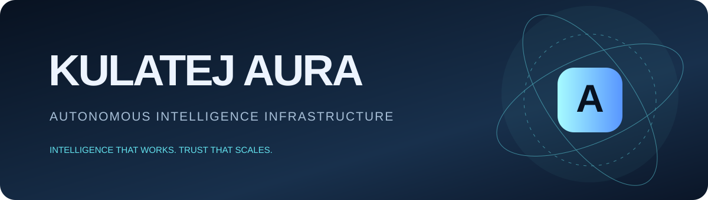
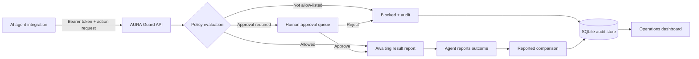

<div align="center">


# KULATEJ AURA
### Autonomous Intelligence Infrastructure
**Intelligence that works. Trust that scales.**

[](https://python.org) [](https://fastapi.tiangolo.com) [](https://pytest.org) [](#status)
</div>

## Overview
**Kulatej AURA** is an early policy and audit layer for AI-agent workflows. Its first product, **AURA Guard**, provides agent registration, scoped action policies, human approval and a record of agent-reported outcomes.

> **Maturity:** This is an early MVP, not a production security product. Integrations must explicitly call this policy API. It does not intercept arbitrary tools, execute external actions, or independently verify external state.

## Product family
| Product | Purpose |
|---|---|
| Kulatej Technologies | Parent brand |
| Kulatej AURA | Autonomous intelligence infrastructure platform |
| AURA Guard | Agent identity, permissions, approvals and audit |
| AURA Connect | Planned integrations and tool gateway |
| AURA Verify | Planned independent outcome verification |
| AURA Control | Planned enterprise governance |

## Current capabilities
- Register agents and issue one-time random bearer credentials; only SHA-256 hashes are stored.
- Evaluate explicit allow-lists and approval-required actions.
- Block actions that are not allow-listed.
- Queue sensitive actions for administrator approval.
- Persist decisions and agent-reported outcomes in SQLite.
- Compare agent-supplied expected and observed values, clearly marked as unverified.
- Responsive browser dashboard for agents, approvals and activity.

## Architecture


## Quick start
Requirements: Python 3.11+.

```bash
git clone https://github.com/kulatej17-personal/Kulatej-Technologies.git
cd Kulatej-Technologies
python -m venv .venv
# macOS/Linux: source .venv/bin/activate
# Windows: .venv\Scripts\Activate.ps1
pip install -e ".[dev]"
cp .env.example .env
uvicorn app.main:app --reload
```

Open the dashboard at http://127.0.0.1:8000, API docs at /docs and health at /health. The local development admin token is `local-dev-change-this-token`; change it before exposing the service to any network.

### Register an agent
```bash
curl -X POST http://127.0.0.1:8000/api/agents \
 -H 'X-Admin-Token: local-dev-change-this-token' -H 'Content-Type: application/json' \
 -d '{"name":"Finance Assistant","description":"Finance workflow agent","allowed_actions":["invoice.read","invoice.prepare","payment.submit"],"approval_actions":["payment.submit"]}'
```
The bearer token is returned once. Store it in a secrets manager.

### Request a policy decision
```bash
curl -X POST http://127.0.0.1:8000/api/actions \
 -H 'Authorization: Bearer YOUR_AGENT_TOKEN' -H 'Content-Type: application/json' \
 -d '{"action":"invoice.read","resource":"invoice/INV-1042","payload":{"purpose":"reconciliation"}}'
```
An unlisted action is blocked. Approval-required actions enter `pending_approval`; allowed actions enter `awaiting_result`. **AURA does not perform the external action.**

### Approve and report
```bash
curl -X POST http://127.0.0.1:8000/api/actions/ACTION_ID/approve \
 -H 'X-Admin-Token: local-dev-change-this-token'

curl -X POST http://127.0.0.1:8000/api/actions/ACTION_ID/result \
 -H 'Authorization: Bearer YOUR_AGENT_TOKEN' -H 'Content-Type: application/json' \
 -d '{"expected_value":"prepared","observed_value":"prepared","evidence_ref":"accounting://events/evt-8821"}'
```
The result is an agent-reported comparison, not independent proof.

## API
| Method | Endpoint | Access | Purpose |
|---|---|---|---|
| GET | /health | Public | Liveness |
| POST | /api/agents | Admin | Register agent |
| GET | /api/agents | Admin | List agents |
| POST | /api/actions | Agent | Evaluate action |
| GET | /api/actions | Admin | Recent actions |
| POST | /api/actions/{id}/approve | Admin | Approve |
| POST | /api/actions/{id}/reject | Admin | Reject |
| POST | /api/actions/{id}/result | Owning agent | Report outcome |

## Status and roadmap
| Capability | Status |
|---|---|
| Agent registry and hashed credentials | Implemented |
| Allow-list policy evaluation | Implemented |
| Human approval / rejection | Implemented |
| SQLite audit persistence | Implemented |
| Agent-reported comparison | Implemented |
| Browser dashboard | Implemented |
| MCP tool gateway | Planned |
| Independent source-system verification | Planned |
| Signed grants and replay protection | Planned |
| Multi-tenant RBAC and SSO | Planned |
| Tamper-evident audit export | Planned |
| Enterprise hardening | Planned |

## Security limitations
Read [SECURITY.md](SECURITY.md). This prototype has a shared administrator secret, no tenant isolation, RBAC/SSO/MFA, rate limiting, independent verification or tamper-evident storage. Do not use it for payments, regulated workloads, sensitive personal data or production execution.

## Development
Install dev dependencies with `pip install -e ".[dev]"`; run `pytest -q` and `ruff check app tests`.

---
<div align="center">**KULATEJ AURA** · Intelligence that works. Trust that scales.</div>
