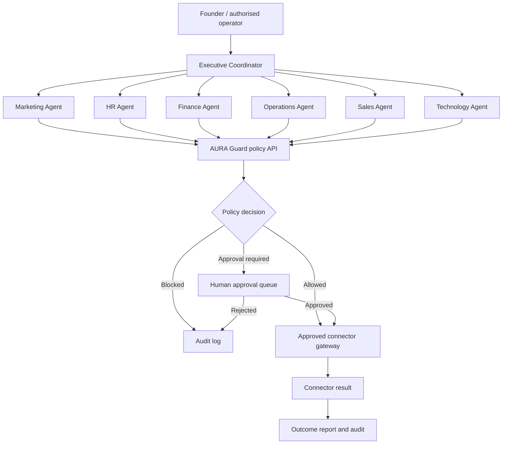

# Kulatej AURA — Department Agent Operating Model

## Goal

Give Kulatej Technologies six specialist AI departments coordinated by one Executive Coordinator:

1. Marketing
2. Human Resources (HR)
3. Finance
4. Operations
5. Sales
6. Technology

The machine-readable starting registry is `departments/registry.json`.

## Important implementation status

**This commit adds department definitions and a safe operating blueprint. It does not yet create six running autonomous agents or connect external SaaS tools.** The current AURA MVP is a policy and audit API: it registers agents, evaluates allow-listed actions, queues approvals and stores agent-reported outcomes. It does not execute external tools or independently verify their results.

Each department therefore has:
- A defined mission and responsibility boundary
- A list of expected tool connectors
- Read-only, draft-only or approval-required access levels
- Deliverables and measurable KPIs
- Human approval gates for consequential actions

## Proposed architecture

## How a request should work

1. The Coordinator classifies the request and selects one or more departments.
2. Each department creates a plan and identifies required tools, data and permissions.
3. The coordinator checks dependencies and asks the operator to approve the plan if needed.
4. Every connector action is sent through AURA Guard before execution.
5. The connector executes only the exact approved operation with least-privilege credentials.
6. The result is recorded with actor, department, tool, timestamp, approval and evidence reference.
7. The department reports what happened, what failed and what needs human attention.

## Tool integration catalogue

The registry uses provider-neutral integration IDs. They are placeholders, not connected accounts:

| Department | Initial connectors to consider |
|---|---|
| Marketing | Web research, website analytics, content management, social channels |
| HR | HR information system, applicant tracking, learning management |
| Finance | Accounting, read-only bank feed, spreadsheets |
| Operations | Project management, documents, service desk |
| Sales | CRM, web research, email drafts, proposal documents |
| Technology | GitHub, CI/CD, cloud metadata, observability |

Connect one provider at a time. Store credentials in environment secrets or a secrets manager; never commit API keys, passwords, tokens or customer data.

## Autonomy levels

- **Level 0 — Analyse:** read approved data and make recommendations.
- **Level 1 — Draft:** prepare content, records, code or transactions but do not submit them.
- **Level 2 — Approved execution:** execute one specific action after an authorised person approves it.
- **Level 3 — Bounded automation:** recurring low-risk actions with explicit limits, monitoring, rollback and a kill switch.

Start every department at Level 0 or 1. Do not enable Level 2 or 3 until connector scopes, audit coverage, idempotency, retries, rate limits, data retention and incident handling have been tested.

## Mandatory human controls

The agents must never independently:
- Send external marketing or sales messages or publish public content.
- Spend, transfer, refund, invest or otherwise move money.
- Create or change payroll, tax submissions or financial commitments.
- Hire, reject, promote, discipline or terminate an employee.
- Sign contracts, accept binding terms or make legal representations.
- Deploy to production, delete data, change access controls or expose secrets.

An agent cannot approve its own request. Approval must identify the exact action, parameters, target system and expiry. Any change to those parameters requires a new approval.

## Suggested implementation phases

### Phase 1 — Department definitions (this commit)
Create the department registry, role boundaries, tool catalogue and approval policy.

### Phase 2 — Agent runtime
Add typed department request/result schemas, coordinator routing, provider/model configuration, per-department prompts and a task queue. Keep model credentials outside source control.

### Phase 3 — Connector gateway
Implement connector interfaces and start with low-risk read-only integrations. Route every consequential action through AURA Guard.

### Phase 4 — Department workspaces
Add dashboards for task queues, drafts, approvals, failures, audit history and department KPIs.

### Phase 5 — Controlled automation
Enable specific approved recurring workflows only after tests, monitoring, rate limits, rollback and operator kill switch are in place.

## Definition of done for a connected department

- Connector account is explicitly authorised and least-privilege.
- Tool schemas and allowed operations are documented.
- Policy checks are enforced server-side, not just in prompts.
- Approval and rejection paths are tested.
- Retries cannot duplicate a payment, message, record or deployment.
- Secrets are stored outside Git.
- Logs exclude credentials and unnecessary personal data.
- Failures stop safely and alert an authorised operator.
- Unit, integration and permission-boundary tests pass.
